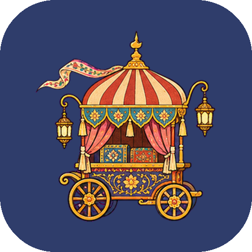
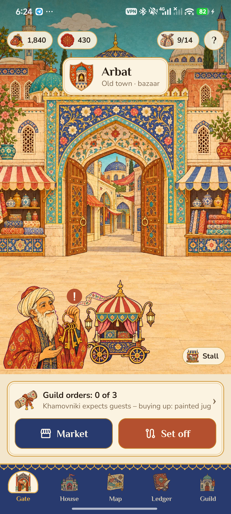
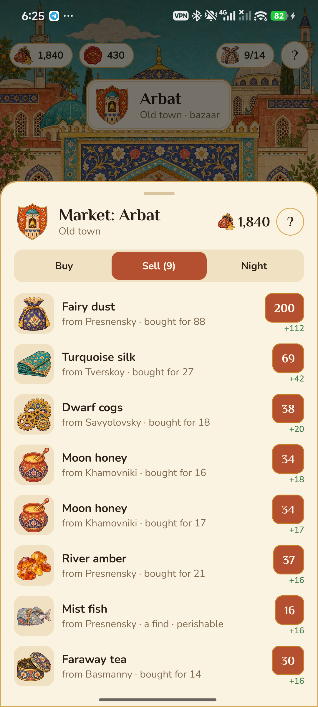
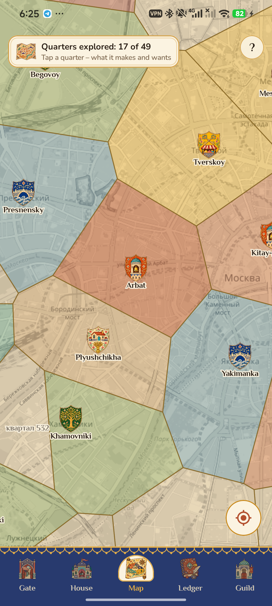
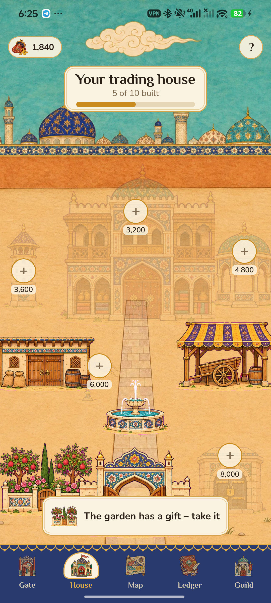
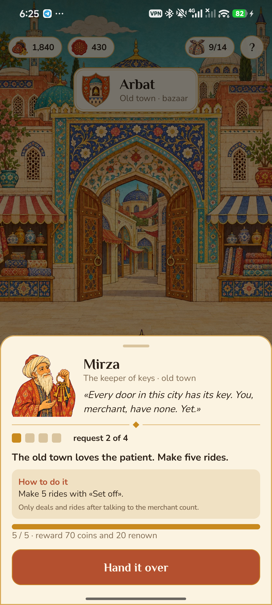
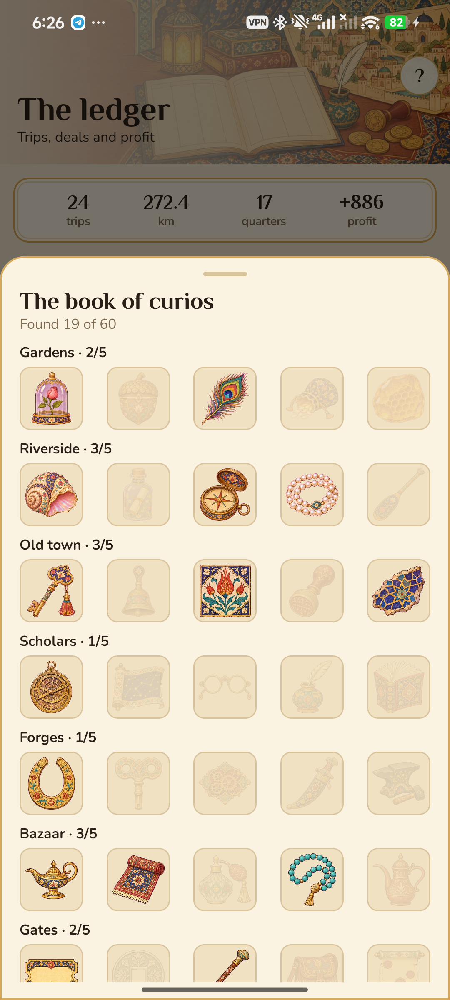
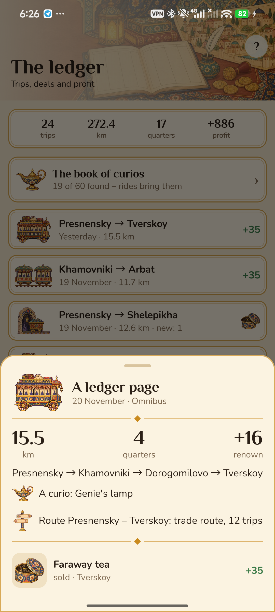
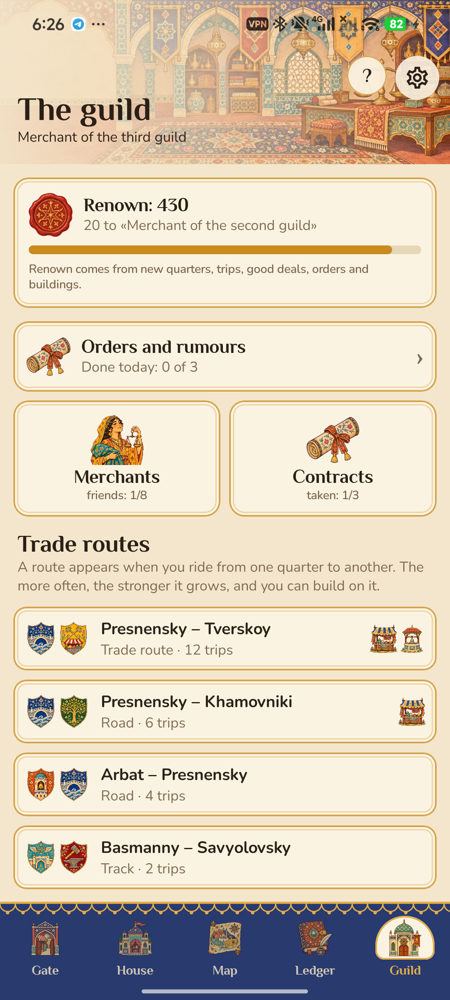

<p align="center"></p>

<h1 align="center">Caravan</h1>

<p align="center">Ride around your city as usual – and trade between its quarters.<br>
<a href="https://bigdevwhale.github.io/stillcraft/apps/caravan/">Website</a> · <a href="https://github.com/bigdevwhale/caravan/releases/latest/download/Caravan.apk">Download APK</a> · <a href="README.ru.md">Русский</a></p>

Your city is a magic bazaar. Each of its districts is a quarter with its own market: moon honey in the gardens, amber by the river, dwarf cogs in the forges. You are a merchant. Buy a good in one quarter, carry it to another and sell it dearer. Your ride to work, to the shops or to friends – by car, bus, tram or underground – becomes your caravan's road.

<p align="center">




</p>

## What's inside

- **Real quarters.** Districts come from OpenStreetMap. What a quarter trades depends on what it has: parks, water, old streets, universities, factories, shops, stations.
- **Prices worth thinking about.** A quarter pays well for the goods it wants and for goods carried from afar. Sell the same thing in one place again and again, and the price drops. Fish and bread go off, and glass may break in a traffic jam.
- **Nothing to tap while driving.** While the car moves, the screen shows only the quarter and the kilometres; the market opens when you stop. A steward sells marked goods for you, wherever they fetch most along the way. As a passenger you can trade on the move.
- **Eight merchants.** The gardener, the boatman, the keeper of keys, the stargazer, the blacksmith, the silk merchant, the caravan leader and the baker – each with four requests and a little story. Do them all and the merchant becomes your friend.
- **Your own trading house.** Ten buildings on your plot – a gate, a garden, a fountain, the hall, a pigeon tower, the treasury and more. Each shows on screen and helps your trade.
- **Something new every day.** Guild orders, rumours («Khamovniki expects guests – buying up painted jugs»), a weekend fair, a night market after a late ride, and the event of the week: drought in the gardens, a festival of fire in the forges, a caravan from the south.
- **The book of curios.** Sixty finds – on the underground, at night, in the rain, on long roads, in quarters of every kind. And after a ride you sometimes meet someone: a wandering pedlar, a fortune-teller, a dice player.
- **Trade routes and stalls.** The route you ride most grows stronger, and you can build on it. Open a stall in another quarter and it trades while you're away.
- **Hard to forget a ride.** When the phone connects to your car, a «The caravan is ready» notification comes. For the bus and the underground there's a quick-settings tile.
- No penalties: a missed day takes nothing away. Light and dark themes, Russian and English.

<p align="center">




</p>

## Install

Download [Caravan.apk](https://github.com/bigdevwhale/caravan/releases/latest/download/Caravan.apk) to a phone with Android 9 or newer, open it and allow the install when Android asks.

## Privacy

No ads, no accounts, no analytics. Your rides and all your progress stay on your phone. Location is read only while the app is open or a ride is on, with a notification on screen. The only things that go online are requests for map tiles, the weather and OpenStreetMap data – with coordinates, but nothing about you. See [PRIVACY.md](PRIVACY.md).

## Build

You need JDK 17+ (Android Studio's JBR will do) and the Android SDK.

```
./gradlew assembleDebug
./gradlew assembleDebug -Pdemo -Pdemolang=en   # app.caravan.demo: a few weeks of play in central Moscow
./gradlew testDebugUnitTest                     # includes BalanceSim – how many days the trading house takes
```

Kotlin, Jetpack Compose, osmdroid. The merchants, goods, curios and scenes were drawn with image generation (`tools/gen_art.py`, `tools/cut.py`).

## License

MIT, see [LICENSE](LICENSE).

Caravan is one of the [StillCraft](https://bigdevwhale.github.io/stillcraft/) apps.
