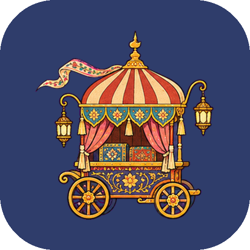
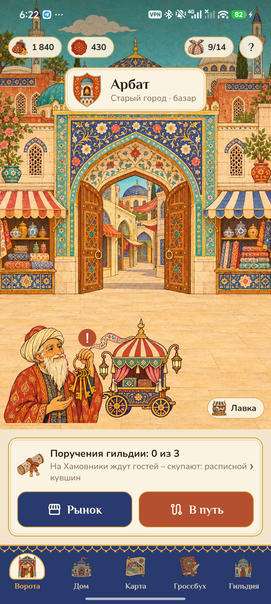
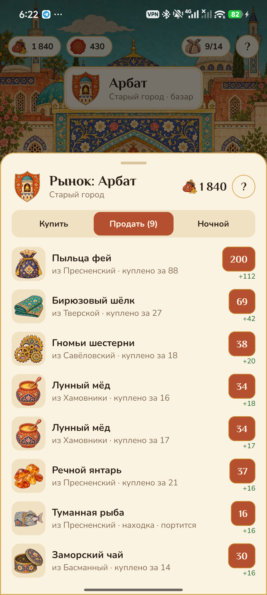
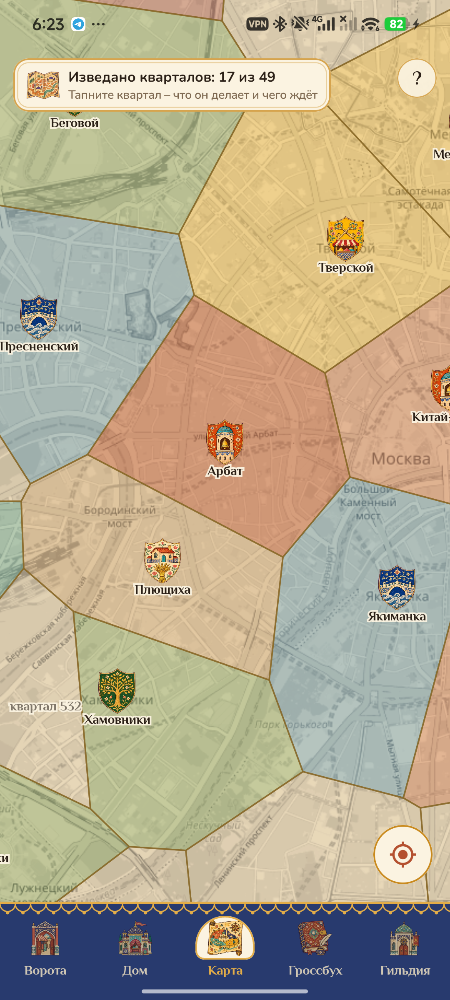
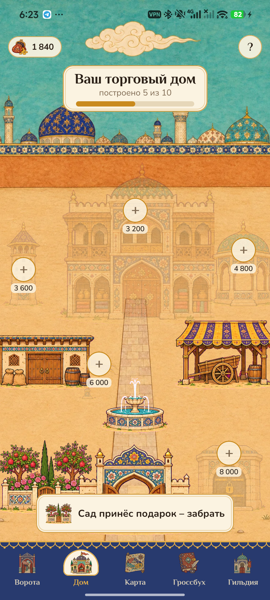
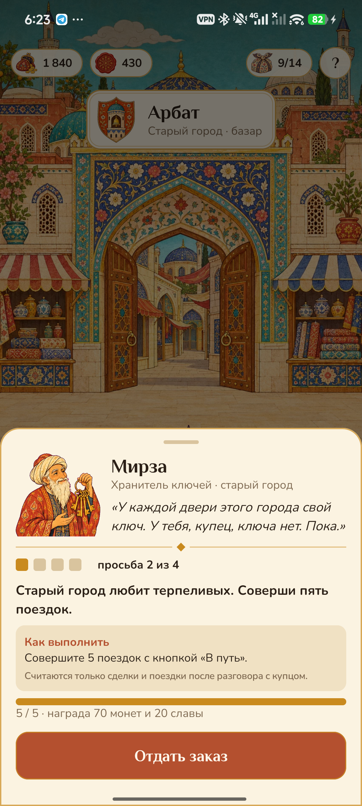
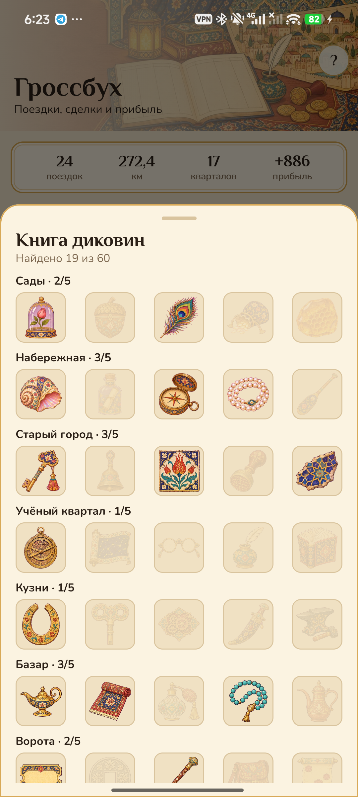
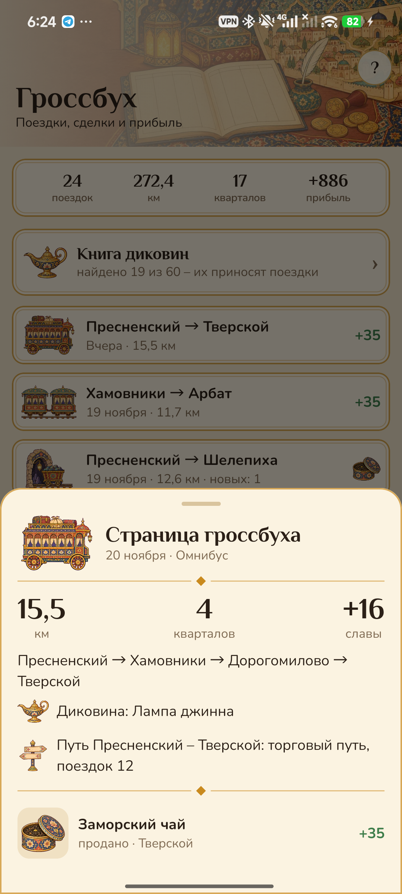
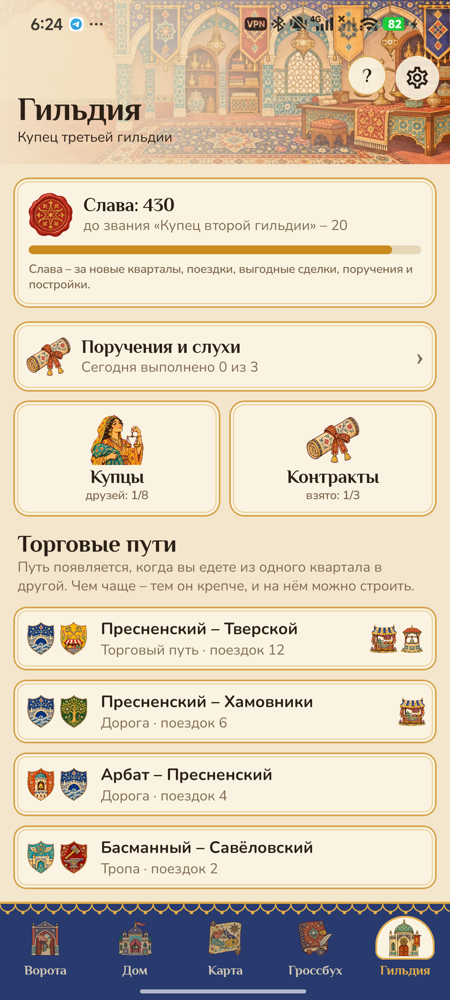

<p align="center"></p>

<h1 align="center">Караван</h1>

<p align="center">Ездите по городу как обычно – и торгуйте между его кварталами.<br>
<a href="https://bigdevwhale.github.io/stillcraft/apps/caravan/">Сайт</a> · <a href="https://github.com/bigdevwhale/caravan/releases/latest/download/Caravan.apk">Скачать APK</a> · <a href="README.md">English</a></p>

Ваш город – волшебный базар. Каждый его район – квартал со своим рынком: в садах продают лунный мёд, у реки – янтарь, в кузнях – гномьи шестерни. Вы купец. Купили товар в одном квартале, отвезли в другой и продали дороже. Дорога на работу, в магазин или в гости – на машине, автобусе, трамвае или метро – становится путём вашего каравана.

<p align="center">




</p>

## Что внутри

- **Настоящие кварталы.** Районы берутся из OpenStreetMap. Чем торгует квартал, зависит от того, что в нём есть: парки, вода, старые улицы, университеты, заводы, магазины, вокзалы.
- **Цены, над которыми стоит подумать.** Квартал дорого платит за товар, которого ждёт, и за привезённый издалека. Если продавать в одном месте одно и то же, цена падает. Рыба и хлеб портятся, а стекло может разбиться в пробке.
- **За рулём ничего нажимать не нужно.** Пока машина едет, на экране только квартал и километры, а рынок открывается на стоянке. Отмеченный товар приказчик продаст сам – там, где по дороге дадут больше всего. Пассажиром можно торговать прямо в пути.
- **Восемь купцов.** Садовница, лодочник, хранитель ключей, звездочёт, кузнец, купчиха, караванщик и пекарь. У каждого четыре просьбы с маленькой историей. Выполните все – и купец станет вашим другом.
- **Свой торговый дом.** Десять построек на участке: ворота, сад, фонтан, палаты, голубятня, сокровищница и другие. Каждая видна на экране и помогает торговать.
- **Каждый день что-то новое.** Поручения гильдии, слухи («в Хамовниках ждут гостей – скупают кувшины»), ярмарка по выходным, ночной рынок после поздней поездки и событие недели: засуха в садах, праздник огня в кузнях, караван с юга.
- **Книга диковин.** Шестьдесят находок: в метро, ночью, под дождём, на дальней дороге, в кварталах разного вида. А после поездки иногда случается встреча – с бродячим торговцем, гадалкой или игроком в кости.
- **Торговые пути и лавки.** Маршрут, по которому вы ездите чаще всего, крепнет, и на нём можно строить. В чужом квартале можно открыть лавку – она торгует, пока вас нет.
- **Поездку трудно забыть.** Телефон подключился к машине – приходит уведомление «Караван готов в путь». Для автобуса и метро есть плитка в шторке быстрых настроек.
- Без штрафов: пропущенный день ничего не отнимает. Светлая и тёмная темы, русский и английский.

<p align="center">




</p>

## Установка

Скачайте [Caravan.apk](https://github.com/bigdevwhale/caravan/releases/latest/download/Caravan.apk) на телефон с Android 9 или новее, откройте файл и разрешите установку, когда Android спросит.

## Конфиденциальность

Без рекламы, аккаунтов и аналитики. Поездки и весь прогресс хранятся только на телефоне. Местоположение приложение берёт, только когда оно открыто или идёт поездка – тогда на экране висит уведомление. В сеть уходят лишь запросы плиток карты, погоды и OpenStreetMap – с координатами, но без каких-либо сведений о вас. Подробнее – в [PRIVACY.md](PRIVACY.md).

## Сборка

Нужны JDK 17+ (подойдёт JBR из Android Studio) и Android SDK.

```
./gradlew assembleDebug
./gradlew assembleDebug -Pdemo -Pdemolang=ru   # app.caravan.demo: несколько недель игры в центре Москвы
./gradlew testDebugUnitTest                     # в том числе BalanceSim – сколько дней уходит на торговый дом
```

Kotlin, Jetpack Compose, osmdroid. Купцы, товары, диковины и сцены нарисованы с помощью генерации изображений (`tools/gen_art.py`, `tools/cut.py`).

## Лицензия

MIT, см. [LICENSE](LICENSE).

Караван – одно из приложений [StillCraft](https://bigdevwhale.github.io/stillcraft/).
